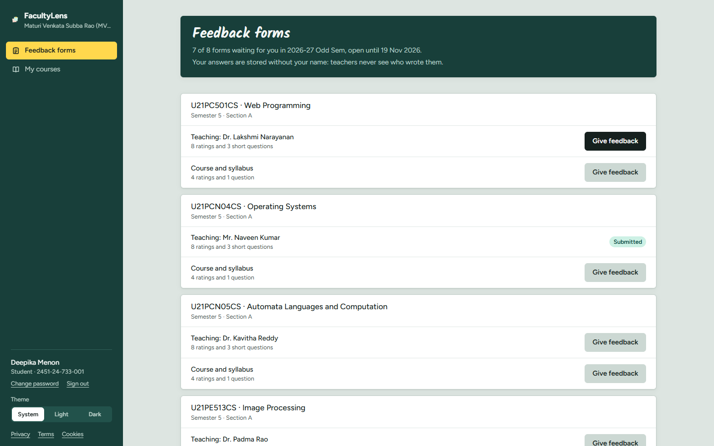
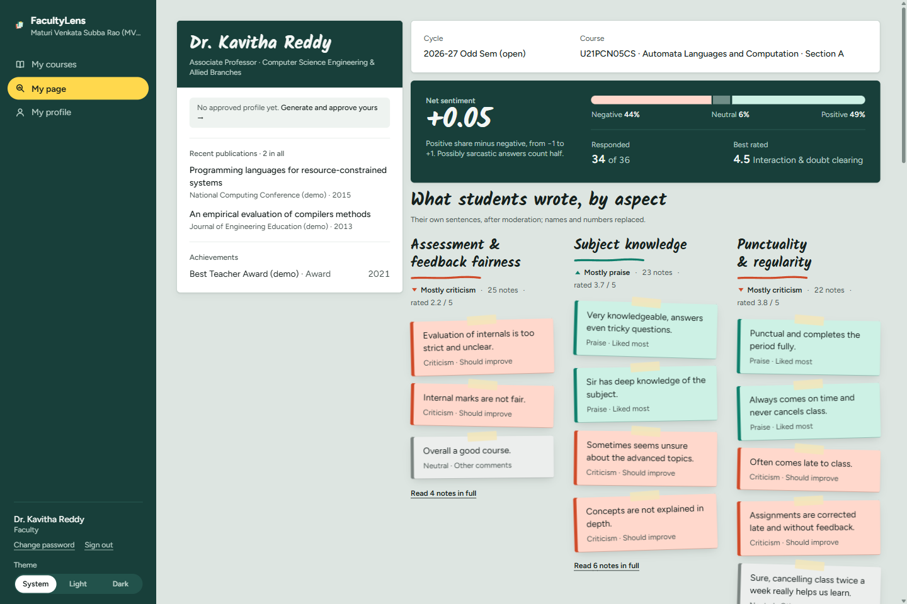
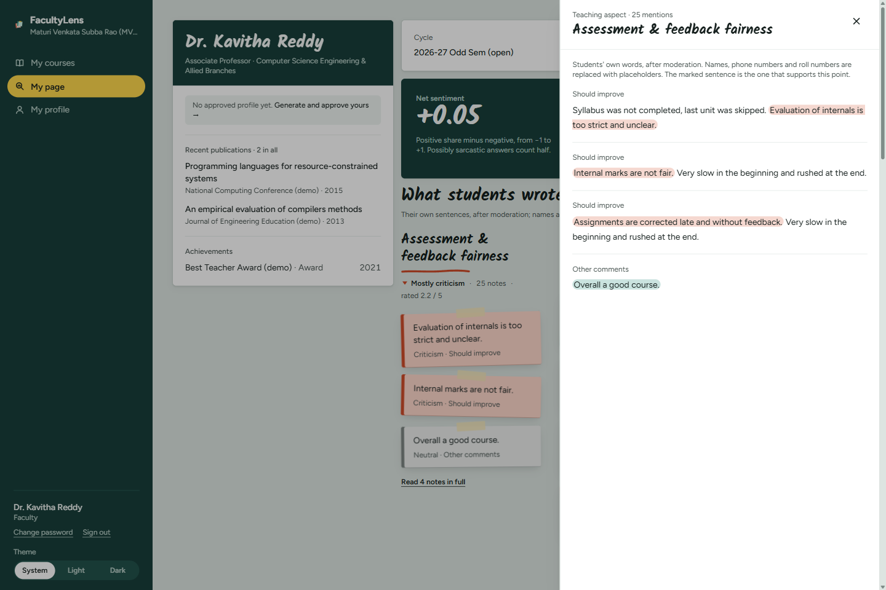
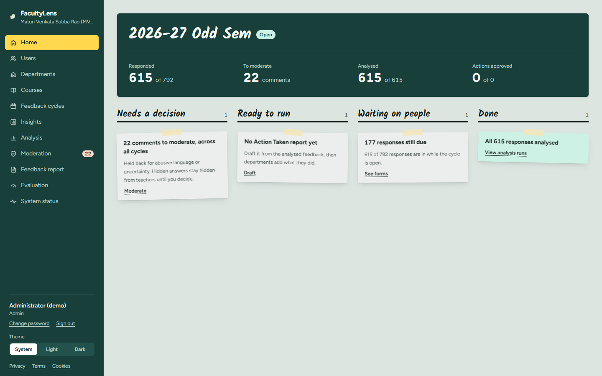
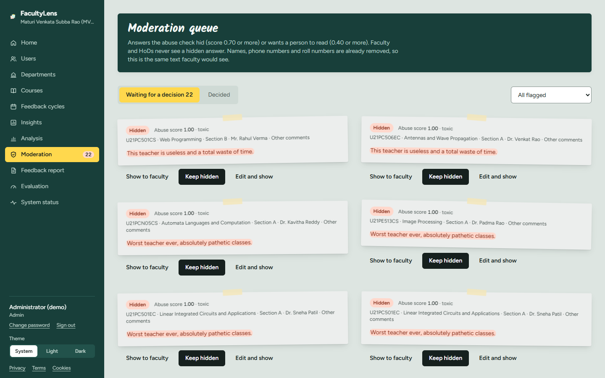
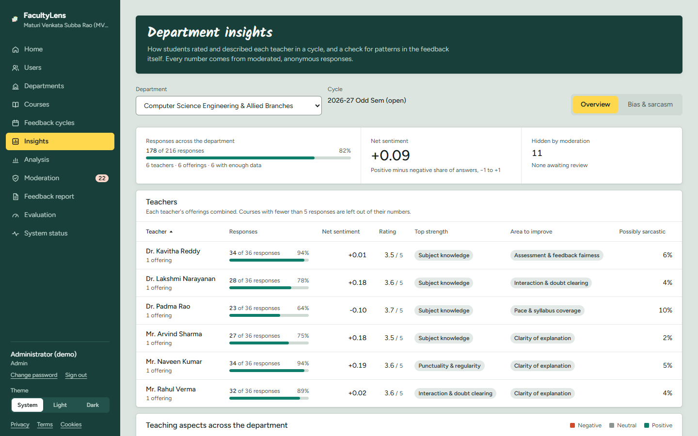
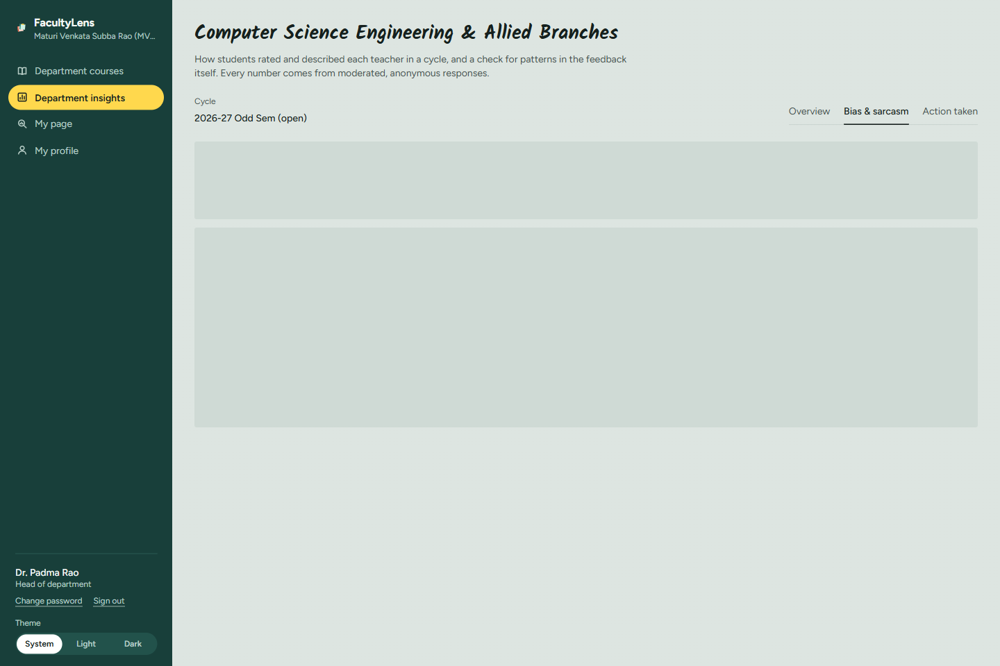
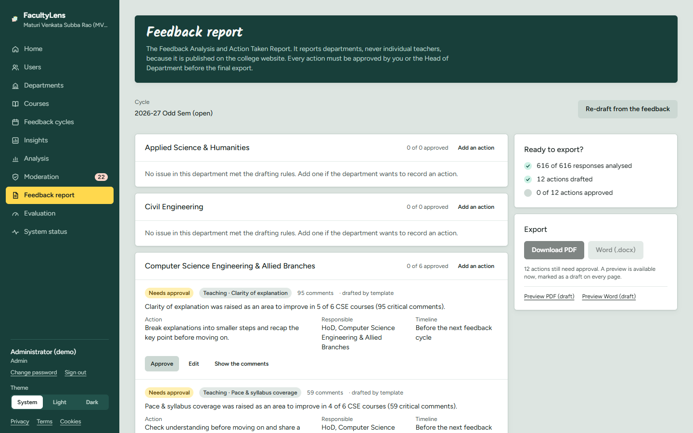
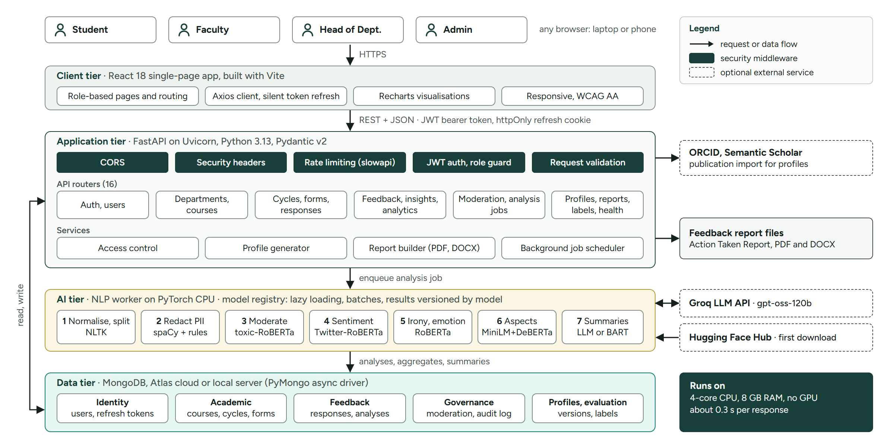

# FacultyLens

## Overview

Faculty profile generation and student feedback evaluation, using text summarization and sentiment analysis.

Colleges collect written student feedback every semester but rarely use it. FacultyLens reads every comment, hides abuse and personal details, scores 8 parts of teaching with the students' own sentences as proof, and shows this next to an automatically written profile of the teacher. It runs on an ordinary CPU.

## Features

- Sentiment for each comment and for 8 teaching areas, with the sentences behind every point
- Faculty profile written from entered and imported facts, approved by the teacher
- Abuse hidden and personal details removed before a teacher reads anything
- Sarcasm flags, emotion mix and a department-level gender-bias check
- Summaries of strengths and areas to improve, each tied to real comments
- Feedback Analysis and Action Taken Report, exported as PDF and Word
- Four roles: student, faculty, head of department and admin

## Presentation

[Project presentation (PDF)](docs/presentation/FacultyLens-Presentation.pdf) · [PowerPoint](docs/presentation/FacultyLens-Presentation.pptx)

## Screenshots
<!-- Screenshots captured from the live app -->

| Student: anonymous feedback forms | Faculty: profile next to the feedback |
|---|---|
|  |  |

| Faculty: the sentences behind each point | Admin: home |
|---|---|
|  |  |

| Admin: moderation queue | Admin and HoD: department insights |
|---|---|
|  |  |

| HoD: bias and sarcasm panel | Admin: Feedback report |
|---|---|
|  |  |

## Architecture



The React app talks to the FastAPI server. When a student submits a form, a background worker analyses it on the CPU and saves the results in MongoDB per model version, so nothing is analysed twice.

## Dataset

Accuracy was measured on public RateMyProfessors reviews, using each student's star rating as the label:

| Model | Accuracy | Macro-F1 |
|---|---:|---:|
| VADER | 0.741 | 0.517 |
| TF-IDF + Logistic Regression | 0.789 | 0.671 |
| TF-IDF + Random Forest | 0.764 | 0.552 |
| Twitter-RoBERTa (used in the app) | 0.815 | 0.647 |
| DistilBERT (fine-tuned on CPU) | 0.807 | 0.653 |

Source: J. He, *Big Data Set from RateMyProfessor.com for Professors' Teaching Evaluation*, Mendeley Data, [doi:10.17632/fvtfjyvw7d.2](https://data.mendeley.com/datasets/fvtfjyvw7d/2), CC BY 4.0. The raw file is not included. Full results: [RESULTS.md](backend/ml/results/RESULTS.md).

## Data Sources

- **Students:** anonymous teaching forms (8 ratings, 3 answers) and syllabus forms (4 ratings, 1 comment)
- **Admin:** departments, users, courses, enrolments and feedback cycles
- **Faculty:** qualifications, experience and publications, typed in or imported from ORCID and Semantic Scholar
- **Demo data:** the seed script creates fictional people and comments for testing

## Tech Stack

| Area | Tools |
|---|---|
| Frontend | React 18, Vite, React Router, Axios, Tailwind CSS, Recharts |
| Backend | Python 3.13, FastAPI, Pydantic, PyMongo (async) |
| Database | MongoDB (Atlas or local) |
| Reports | fpdf2 (PDF), python-docx (Word) |
| Testing | pytest, Ruff, ESLint, GitHub Actions |

## API, AI, ML & NLP

All four are used. NLP is what the project does with student comments, the ML models are how it does it, an LLM (AI) writes the summaries, and APIs connect everything.

### API

- **Our REST API:** a FastAPI backend with 79 endpoints in `backend/app/routers/` (login, users, courses, forms, feedback, analysis, profiles, reports, evaluation, health). The React website calls it through one Axios client. See the [Postman collection](postman/FacultyLens.postman_collection.json).
- **Outside APIs:** Groq (LLM summaries), plus ORCID and Semantic Scholar (importing a teacher's publications). All three are optional; the app keeps working without them.

### AI (large language model)

- **Groq**, model `openai/gpt-oss-120b`, falling back to `openai/gpt-oss-20b` (`backend/app/nlp/llm.py`).
- Writes the strengths and areas to improve for each form, drafts profile text, and drafts actions for the report (`summarize.py`, `profile_gen.py`, `atr.py`).
- It only sees cleaned-up comments, must answer in JSON, and every point must cite real comment ids, so it cannot invent claims. Without a key, a local model and templates write the summaries instead.

### Hugging Face models

All models are downloaded once from Hugging Face (`python -m app.nlp.registry --download`) and run on the CPU with PyTorch. They are listed in one place, `backend/app/nlp/registry.py`, which loads each model only when it is first needed and keeps it in memory. Classifiers are loaded with `AutoTokenizer` and `AutoModelForSequenceClassification`, inputs are cut to 256 tokens, and batches run under `torch.inference_mode()`.

| Model | What it does in FacultyLens | Used in |
|---|---|---|
| [cardiffnlp/twitter-roberta-base-sentiment-latest](https://huggingface.co/cardiffnlp/twitter-roberta-base-sentiment-latest) | Marks each answer and each sentence positive, negative or neutral | `nlp/analyze.py` |
| [sentence-transformers/all-MiniLM-L6-v2](https://huggingface.co/sentence-transformers/all-MiniLM-L6-v2) | Turns sentences into vectors and finds which of the 8 teaching areas a sentence is about (cosine similarity) | `nlp/aspects.py` |
| [yangheng/deberta-v3-base-absa-v1.1](https://huggingface.co/yangheng/deberta-v3-base-absa-v1.1) | Says whether a sentence is positive or negative about that teaching area | `nlp/analyze.py` |
| [unitary/unbiased-toxic-roberta](https://huggingface.co/unitary/unbiased-toxic-roberta) | Scores abuse per sentence: 0.70 or more is hidden, 0.40 or more goes to the admin | `nlp/analyze.py`, `nlp/scoring.py` |
| [j-hartmann/emotion-english-distilroberta-base](https://huggingface.co/j-hartmann/emotion-english-distilroberta-base) | Gives the mix of 7 emotions in each answer | `nlp/analyze.py` |
| [cardiffnlp/twitter-roberta-base-irony](https://huggingface.co/cardiffnlp/twitter-roberta-base-irony) | Flags answers that may be sarcastic | `nlp/analyze.py` |
| [sshleifer/distilbart-cnn-12-6](https://huggingface.co/sshleifer/distilbart-cnn-12-6) | Writes summaries when Groq is not available | `nlp/summarize.py` |
| [distilbert-base-uncased](https://huggingface.co/distilbert-base-uncased) | Fine-tuned on CPU for the accuracy comparison, and used to compute BERTScore (evaluation only) | `ml/finetune.py`, `ml/evaluate.py` |

`ML_MODE=full` swaps in larger models for two tasks (`all-mpnet-base-v2` and `facebook/bart-large-cnn`); the default `light` mode uses the models above.

### ML (machine learning)

- **In the app:** the pretrained Hugging Face models above. They are used as they are, not trained by us.
- **In the evaluation (`backend/ml/`):** we trained our own models and compared them with the pretrained one on public RateMyProfessors reviews: TF-IDF with Logistic Regression and with Random Forest (scikit-learn), and DistilBERT fine-tuned on CPU. Twitter-RoBERTa scored best (0.815 accuracy), so the app uses it. See [Dataset](#dataset).
- TF-IDF is also used in the app to pick keywords for teacher profiles (`profile_gen.py`).

### NLP (natural language processing)

| Step | Tool | Where |
|---|---|---|
| Clean text and split it into sentences | NLTK | `nlp/preprocess.py` |
| Remove names, phone numbers, emails, roll numbers and links | spaCy `en_core_web_sm` plus patterns | `nlp/pii.py` |
| Sentiment, aspect sentiment, abuse, emotion, sarcasm | Hugging Face models above | `nlp/analyze.py` |
| Summaries | Groq, or DistilBART and templates | `nlp/summarize.py` |
| Word-list baseline | VADER | `ml/baseline.py` |

## Security

- Login with a 60-minute access token (JWT) and a 7-day refresh cookie (httpOnly, SameSite strict)
- Passwords hashed with bcrypt (12 rounds); new and reset accounts must change their password
- Login limited to 30 attempts per minute per address
- Role check on every endpoint
- Security headers and a restricted CORS origin
- Secrets live only in `.env`, which is never committed

## Privacy

- Students are stored only as a one-way code per form (HMAC-SHA256 with a secret salt), so their answers can't be linked across forms
- Names, phone numbers, emails, roll numbers and links are removed before analysis
- Abusive comments are hidden until the admin reviews them
- Teachers see only cleaned-up comments, and only once a form has 5 or more responses

## Run Locally

You need Python 3.13, Node 22, MongoDB and about 7 GB of free disk for the models.

From `backend`:

```bash
py -3.13 -m venv .venv
.venv\Scripts\activate
pip install torch --index-url https://download.pytorch.org/whl/cpu
pip install -r requirements-dev.txt
python -m spacy download en_core_web_sm
```

Copy `.env.example` to `.env` and set `JWT_SECRET` and `STUDENT_HASH_SALT`. `GROQ_API_KEY` is optional.

```bash
python -m app.nlp.registry --download
python -m app.seed
uvicorn app.main:app --port 8000
```

From `frontend`:

```bash
npm install
npm run dev
```

Open http://localhost:5173.

**After the first setup**, start everything with one command from the project folder:

```bash
.\start.cmd
```

It checks the setup and the database, starts the API and the website in their own windows, and opens the site. Close those two windows to stop it.

## Future Enhancements

- Trends across semesters, with alerts
- Training on real MVSR comments, and better name detection
- Understanding Telugu-English and Hindi-English comments
- Single sign-on with the college portal
- A mobile app for students
- Hosting on a college server with HTTPS

## Author

- Ch. Varshith Vardhan (2451-24-751-010)
- D. Akhil Reddy (2451-24-751-014)
- M. Rohnith Reddy (2451-24-751-041)

Guided by Dr. M V R Jyothisree, Associate Professor, Dept. of CSE-Allied, MVSR Engineering College.

## License

[MIT](LICENSE)
