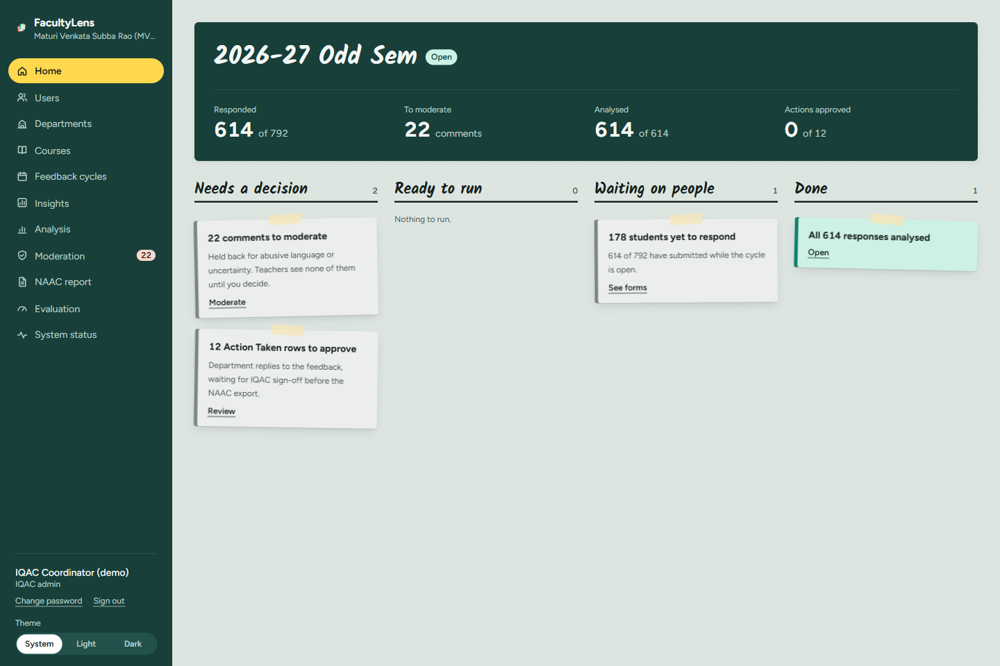
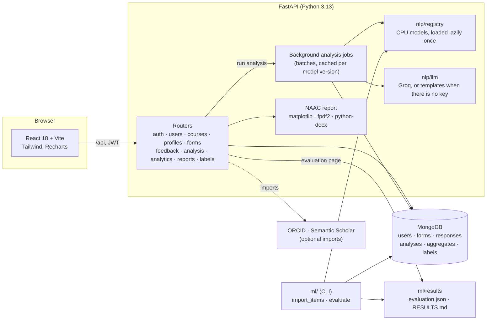

# FacultyLens

**Faculty Profile Generation and Student Feedback Evaluation based on Text Summarization and Sentiment Analysis.** This is a B.Tech mini project (AI & NLP).

FacultyLens builds one page per faculty member. It joins an auto-generated profile with an analysis of anonymous student feedback:
- aspect-level sentiment with evidence;
- moderation and PII redaction before any teacher reads a word;
- a bias & sarcasm panel;
- a NAAC Criterion 1.4 Feedback Analysis and Action Taken Report;
- an honest evaluation against human labels.

Everything runs on a CPU, and offline once the models are downloaded.

| The unified faculty page | Evidence behind every point | Bias & sarcasm panel |
|---|---|---|
|  |  |  |

The IQAC home board: 

More screens are in [`docs/screenshots`](docs/screenshots). A 5-minute demo script is in [`docs/DEMO.md`](docs/DEMO.md). Requirements are in [`docs/SPEC.md`](docs/SPEC.md), the design system in [`docs/DESIGN.md`](docs/DESIGN.md), and measured model speed and memory in [`docs/MODEL_CHECK.md`](docs/MODEL_CHECK.md).

> **Status:** all nine phases of SPEC §14 are built. The human-labelled parts of the evaluation are pending until the annotators label (see [Evaluation](#evaluation)).

## Contents

- [Quick start](#quick-start)
- [Demo data](#demo-data)
- [Architecture](#architecture)
- [What each role sees](#what-each-role-sees)
- [Evaluation](#evaluation)
- [Testing](#testing)
- [Limitations](#limitations)
- [Future work](#future-work)
- [Troubleshooting](#troubleshooting)
- [Credits](#credits)

## Quick start

> **Moving to another laptop?** Follow [`SETUP_NEW_LAPTOP.md`](SETUP_NEW_LAPTOP.md): it covers secrets, data backup and restore, and the Claude setup.

### Prerequisites

- **Python 3.13** and **Node 22+** (developed on Node 24).
- **MongoDB Community Server** running on `127.0.0.1:27017`. Use `127.0.0.1`, not `localhost`: a default local install listens on IPv4 only.
- About **7 GB** of free disk for the models. No GPU is needed; 8 GB of RAM is enough.

### 1. Backend

Run each command on its own line. On Windows PowerShell 5.1, `&&` does not work.

```bash
cd backend
```

Create and activate a virtual environment.
- **Windows:**

  ```bash
  py -3.13 -m venv .venv
  ```

  ```bash
  .venv\Scripts\activate
  ```

- **Mac or Linux:**

  ```bash
  python3.13 -m venv .venv
  ```

  ```bash
  source .venv/bin/activate
  ```

Install the CPU build of PyTorch first, then the rest:

```bash
pip install torch --index-url https://download.pytorch.org/whl/cpu
```

```bash
pip install -r requirements-dev.txt
```

```bash
python -m spacy download en_core_web_sm
```

Teammates labelling from their own laptops against the shared cloud database follow the shorter [`docs/TEAM_SETUP.md`](docs/TEAM_SETUP.md) instead.

Copy `.env.example` to `.env`: `copy .env.example .env` on Windows, `cp .env.example .env` on Mac or Linux. Then set `JWT_SECRET` and `STUDENT_HASH_SALT` to long random strings; the API refuses to start while either still has its placeholder value. `GROQ_API_KEY` is optional; without it the app uses its no-LLM fallback.

Download the models once (about 7 GB, cached in `backend/.hf_cache`; this is the only step that needs a fast connection):

```bash
python -m app.nlp.registry --download
```

Load the demo data, then start the API (docs at http://127.0.0.1:8000/docs):

```bash
python -m app.seed
```

```bash
uvicorn app.main:app --reload --port 8000
```

### 2. Frontend

In a second terminal:

```bash
cd frontend
```

```bash
npm install
```

```bash
npm run dev
```

Open http://localhost:5173. The dev server proxies `/api` to `127.0.0.1:8000`; set `VITE_API_TARGET` to use another address.

### 3. Sign in and analyse

1. Sign in as the admin, `iqac@demo.facultylens.in`. The password is `DEMO_PASSWORD` in `backend/.env.example`.
2. Open **Analysis** and press **Analyse waiting responses**. The first batch loads the models (about 45 s); the whole cycle takes about 3 minutes on a 4-core CPU.
3. Sign in as each role (below), or follow [`docs/DEMO.md`](docs/DEMO.md).

For a real deployment, serve the app over HTTPS, set `COOKIE_SECURE=true` and `FRONTEND_ORIGIN` to the site's address in `.env`, skip the seed, and create the first IQAC admin. It prints a temporary password once:

```bash
python -m app.cli create-admin --email iqac@yourcollege.ac.in --name "IQAC Coordinator"
```

## Demo data

`python -m app.seed` fills an empty database with **synthetic** demo data set in **Maturi Venkata Subba Rao (MVSR) Engineering College**, Hyderabad:
- the college's 8 departments, from [mvsrec.in](https://mvsrec.in/departments.php); only CSE and ECE have demo staff, students and feedback;
- 11 semester-V offerings with real course codes and names from MVSR's R21 B.E. scheme (for example U21PCN05CS Automata Languages and Computation);
- 11 teaching staff and 144 students, with roll numbers in the college's Osmania University format (`2451-24-733-001`: college code, admission year, branch code, serial);
- an open "2026-27 Odd Sem" cycle with 326 teaching and 288 syllabus responses.

**Every person is fictional.** No real MVSR teacher's name appears, so no invented feedback sits under a real name. The comments are hand-written sentence banks, not real student feedback. Every document is marked `is_synthetic` and is never used in the evaluation.

| Role | Sign in as |
|---|---|
| IQAC admin | `iqac@demo.facultylens.in` |
| HoD (CSE) | `padma.rao@demo.facultylens.in` |
| Faculty | `kavitha.reddy@demo.facultylens.in` |
| Student | any roll number from `2451-24-733-001` (CSE) or `2451-24-735-001` (ECE) |

`python -m app.seed --reset` removes only the synthetic data. The seed refuses to run on a database that already has real users.

## Architecture



- **Pipeline (SPEC §5):** each answer goes through normalise → PII redaction (spaCy names plus patterns) → toxicity moderation → sentiment → aspect detection (MiniLM similarity plus a lexicon) with aspect polarity (DeBERTa ABSA) → emotion → irony. Results are stored per response and per `model_version`, so nothing is scored twice.
- **Models** (`app/nlp/registry.py`), all CPU:
  - `cardiffnlp/twitter-roberta-base-sentiment-latest`
  - `sentence-transformers/all-MiniLM-L6-v2`
  - `yangheng/deberta-v3-base-absa-v1.1`
  - `unitary/unbiased-toxic-roberta`
  - `j-hartmann/emotion-english-distilroberta-base`
  - `cardiffnlp/twitter-roberta-base-irony`
  - `sshleifer/distilbart-cnn-12-6`
  - spaCy `en_core_web_sm`
- **Privacy:**
  - A student is stored only as a salted one-way code per form.
  - Teachers see moderated, redacted text, and only from 5 responses up.
  - The bias panel and the NAAC report never name a teacher.

## What each role sees

**Students** fill one teaching form per teacher and one syllabus form per course: 8 ratings and 3 short questions. Every screen says plainly how answers are stored.

**Faculty**
- **My page** puts the approved profile beside the feedback for one course at a time:
  - net sentiment and its split;
  - grounded strengths and areas to improve, where **Show the evidence** opens the redacted answers with the supporting sentence marked;
  - every teaching aspect with its rating, and whether ratings and comments agree;
  - the emotion mix, and the sarcasm and moderation counts.
- **My profile:** facts imported from ORCID or Semantic Scholar wait for review, and nothing reaches the profile until it is accepted.
- **Generated profile:** a draft written only from the saved facts, checked claim by claim. The teacher edits and approves it.
- **Survey:** a short usefulness survey at the foot of My page.

**HoDs** get everything faculty get, plus **Department insights** for their department:
- **Overview:** a sortable table of teachers.
- **Bias & sarcasm panel:**
  - It compares feedback by the gender the IQAC office recorded, never shown next to a name. It looks at ability and warmth words, the rating gap per aspect with a 95% interval in which each teacher counts once, emotion, and possible sarcasm.
  - It hides itself unless each group has at least 3 teachers and 30 answers.
- **Action taken:** they edit and approve the NAAC rows for their department.

**The IQAC admin**
- **Setup:** users (one at a time or by CSV), departments, courses and enrolment, and feedback cycles.
- **Analysis and Moderation:** answers the abuse check hides stay hidden until a person decides.
- **Insights:** any department.
- **NAAC report:**
  - Draft the Action Taken rows; each is an issue for a whole department, such as "raised in 4 of 6 CSE courses".
  - Edit and approve them.
  - Export the Criterion 1.4 report as PDF and Word. Draft previews are watermarked, and the final export unlocks when every row is approved.
- **Evaluation:** the evaluation results.
- **System status:** the models that are loaded, memory, and the LLM.

Measured on this project's demo data (details in `docs/MODEL_CHECK.md`):
- The cycle analyses in about 3 minutes on a 4-core CPU.
- Analytics answer in under 35 ms at p95.
- The NAAC PDF builds in under 2 s.

## Evaluation

The full report is [`backend/ml/results/RESULTS.md`](backend/ml/results/RESULTS.md). The admin sees the same numbers on the **Evaluation** page.

**Data.** The evaluation uses no synthetic data. It uses:
- public student reviews: the RateMyProfessors sample by Jibo He (Mendeley Data, [DOI 10.17632/fvtfjyvw7d.2](https://data.mendeley.com/datasets/fvtfjyvw7d/2), CC BY 4.0);
- this college's real comments, once collected.

To set up the data:
1. Download `RateMyProfessor_Sample data.csv` from that page into `backend/ml/data/rmp/`. The folder is gitignored because the file contains real names.
2. Run:

```bash
python -m ml.import_items --rmp
```

The import keeps only each comment (redacted), the student's star rating and a one-way teacher key.

**Labelling.** On the **Users** page, the admin marks two staff accounts as *Annotator* and one as *Adjudicator*. Use real accounts: labels from demo accounts never count.
1. Each annotator opens **Labelling** and labels the same 300 comments on their own: sentiment with keys 1–3, plus the aspects mentioned.
2. Each annotator writes reference summaries for 20 teachers and checks the generated summaries against their evidence.
3. The adjudicator settles the disagreements.

Then run:

```bash
python -m ml.evaluate
```

Add `--finetune` to also fine-tune DistilBERT on the CPU, which took about 15 minutes here. Results go to `ml/results/`.

**Results so far.** These come from `ml/results/evaluation.json` (2026-10-21).
- **Sentiment, scored against each student's own star rating** (weak labels: 2,388 training and 611 test comments, split by teacher):

  | Model | Accuracy | Macro-F1 |
  |---|---:|---:|
  | VADER | 0.741 | 0.517 |
  | TF-IDF + Logistic Regression | 0.789 | **0.671** |
  | TF-IDF + Random Forest | 0.764 | 0.552 |
  | Twitter-RoBERTa (pretrained, zero-shot) | **0.815** | 0.647 |
  | DistilBERT (fine-tuned on CPU, 2 epochs) | 0.807 | 0.653 |

  The transformers are the most accurate, but the classical baseline trained on these reviews handles the *neutral* class better, so it has the best macro-F1. Every model is weak on neutral (F1 0.04–0.38). A star rating is a weak label for tone, so the human gold set will settle this.
- **Moderation and PII, on a hand-built set of 50 tricky sentences:**
  - Abuse: recall 1.00, precision 0.73. Four harsh but fair comments were hidden and wait for a person in the moderation queue.
  - Every phone number, roll number, email and link was redacted (recall 1.00).
- **Pending, until the team labels:** kappa, the human-gold sentiment and aspect scores, ROUGE/BERTScore against human references, the grounding rate, and the faculty survey. The report says *pending* for each; nothing is estimated.

## Testing

In `backend`:

```bash
pytest -q
```

```bash
pytest -q --cov=app --cov-fail-under=70
```

```bash
ruff check .
```

- **The fast suite** needs MongoDB. It uses a separate `facultylens_test` database and drops it afterwards. It includes:
  - a role matrix that calls every endpoint as each role and checks the 401/403 answers;
  - a test that every endpoint has a Postman request.
- **Coverage of `app/`** is 89% (562 tests; the target is 70%).
- **`pytest -m slow`** loads every real model. **`pytest -m network`** imports two real public ORCID records.
- **Frontend:** in `frontend`, run `npm run lint` and `npm run build`.
- **Postman:** [`postman/FacultyLens.postman_collection.json`](postman/FacultyLens.postman_collection.json) has a request for every endpoint. Set `baseUrl`, sign in with the first request, and the rest reuse the token.

## Limitations

- **English only:** code-mixed comments (Hinglish, Telugu-English) are flagged "low confidence" but not understood.
- **The evaluation's human-labelled numbers are still pending.** The benchmark labels come from star ratings, which are weak labels for tone. The public reviews are from US colleges, not Indian engineering colleges.
- **The abuse model reacts to words, not meaning:** it hides some fair criticism, such as a comment containing "stupid". That's why every hidden answer waits for a person.
- **Name detection over-reaches:** spaCy sometimes redacts things that aren't names, such as a grade or a school. That is the safe side, but some evidence loses words.
- **The bias panel needs at least 3 teachers per group.** With so few, intervals are wide, and the panel says "no clear difference" more often than not.
- **The no-LLM summaries are template sentences** plus an extractive digest. Groq summaries need a free key, and no LLM-versus-template numbers exist without one.
- **Students are the only stakeholder surveyed;** NAAC 1.4 also asks for teachers, alumni, employers and parents.

## Future work

- Code-mixed (Hinglish / Telugu-English) sentiment and aspect models.
- Semester-on-semester trends with alerts when an aspect drops.
- A question-answering chatbot over a department's feedback (RAG), grounded the same way the summaries are.
- CSV/Excel import of feedback collected on paper or Google Forms.
- Feedback forms for the other NAAC stakeholders, and a mobile app.

## Troubleshooting

| Problem | Fix |
|---|---|
| "MongoDB is not reachable" | Start the MongoDB service, and use `mongodb://127.0.0.1:27017` in `.env` (not `localhost`). |
| `&&` errors in PowerShell | Run each command on its own line. |
| The first analysis is slow | Models load once (about 45 s). Run `python -m app.nlp.registry --download` beforehand so nothing downloads during a demo. |
| Port 8000 or 5173 in use | Start uvicorn with another `--port`, and run `npm run dev -- --port 5180` with `VITE_API_TARGET=http://127.0.0.1:<port>`. |
| Semantic Scholar says "limiting requests" | Its shared rate limit is low. Wait a minute, or put a free key in `S2_API_KEY`. |
| A course shows no feedback | Feedback appears from 5 responses (`MIN_RESPONSES_FOR_DISPLAY`). Comments appear after analysis. |
| Groq errors | The app falls back to templates. Check `GROQ_MODEL` against https://console.groq.com/docs/models. |

## Credits

- **Evaluation data:** Jibo He, *Big Data Set from RateMyProfessor.com for Professors' Teaching Evaluation*, Mendeley Data, V2, 2020, DOI 10.17632/fvtfjyvw7d.2, licensed CC BY 4.0. Only redacted comments and star ratings are used, and the raw file is not redistributed here.
- **Institution:** the institution details (name, departments, course codes) are from MVSR Engineering College's public website and syllabus. All people in the demo data are fictional.
- **Models:** the pretrained models are by their authors on Hugging Face (see the list above).

## Repository layout

```
backend/   FastAPI app (app/), evaluation (ml/), tests
frontend/  React 18 + Vite + Tailwind v4
docs/      SPEC, DESIGN, MODEL_CHECK, DEMO, screenshots
postman/   API collection
```
