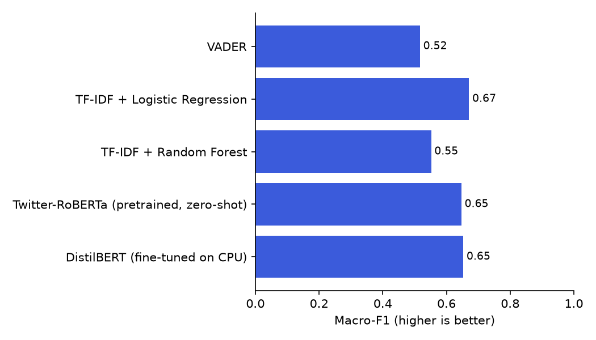
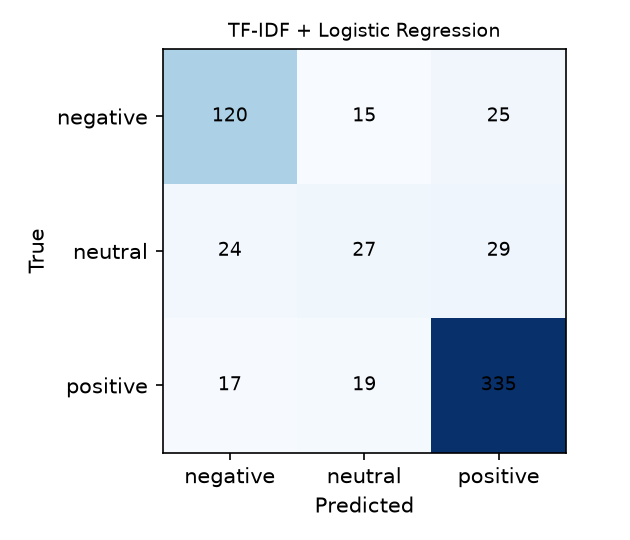

# FacultyLens evaluation results

Generated by `python -m ml.evaluate` on 2026-10-21T06:03:01+00:00 (`model_version=light-r1-912bb0b3`). Every number below comes from `ml/results/evaluation.json`; a section marked *pending* has no number yet because the human labels it needs do not exist yet.

## Data

- **Public dataset:** Big Data Set from RateMyProfessor.com for Professors' Teaching Evaluation (Jibo He, Mendeley Data, DOI 10.17632/fvtfjyvw7d.2, licence CC BY 4.0). Only the comment text, the student's own star rating and a one-way professor key are kept; every comment was redacted by the app's PII step before storage.
- **Benchmark labels come from the students' own star ratings** (RateMyProfessors bands: 3.5–5 positive, 2.5–3 neutral, 1–2 negative). A star rating is not a reading of the comment's tone, so these are weak labels; the human-labelled set is the real test.
- **Domain gap:** these are reviews of US college teachers, not Indian engineering colleges. Real MVSR comments join the labelling queue as they are collected.
- Labelling set: 300 comments; gold labels so far: 0. Synthetic seed data is never used.

## Inter-annotator agreement (Cohen's kappa)

*Pending:* 0 of 30 comments labelled by both annotators.

## Sentiment: benchmark scored against star ratings

Train 2388, test 611 (test classes: {'positive': 371, 'neutral': 80, 'negative': 160}).

| Model | Accuracy | Macro-F1 | F1 neg | F1 neu | F1 pos | Negation slice macro-F1 (n) |
|---|---:|---:|---:|---:|---:|---:|
| VADER | 0.741 | 0.517 | 0.646 | 0.041 | 0.863 | 0.488 (318) |
| TF-IDF + Logistic Regression | 0.789 | 0.671 | 0.748 | 0.383 | 0.882 | 0.665 (318) |
| TF-IDF + Random Forest | 0.764 | 0.552 | 0.742 | 0.068 | 0.847 | 0.539 (318) |
| Twitter-RoBERTa (pretrained, zero-shot) | 0.815 | 0.647 | 0.803 | 0.228 | 0.911 | 0.653 (318) |
| DistilBERT (fine-tuned on CPU) | 0.807 | 0.653 | 0.784 | 0.263 | 0.914 | 0.643 (318) |

 

## Sentiment: human gold labels

*Pending:* 0 of 100 gold-labelled comments.

## Aspect detection and polarity (human gold)

*Pending:* 0 of 100 gold-labelled comments.

## Moderation and PII (hand-built 50-sentence test set)

The set (`ml/data/moderation_pii_set.jsonl`) was written by hand for this project with edge cases: harsh but fair criticism, words like *stupid* or *killing* used harmlessly, sarcasm, Indian names and titles, phone numbers in several formats, OU roll numbers, dates and course codes that look like numbers. Its labels follow from how each sentence was written. It is small, so treat these as a sanity check.

| Check | Precision | Recall | F1 | Support |
|---|---:|---:|---:|---:|
| Abuse hidden (≥ 0.7) | 0.733 | 1.000 | 0.846 | 11 |
| Abuse hidden or sent to review (≥ 0.4) | 0.733 | 1.000 | 0.846 | 11 |
| PII: EMAIL | 1.000 | 1.000 | 1.000 | 2 |
| PII: FACULTY | 0.875 | 1.000 | 0.933 | 7 |
| PII: NAME | 1.000 | 0.750 | 0.857 | 4 |
| PII: PHONE | 1.000 | 1.000 | 1.000 | 5 |
| PII: ROLL | 1.000 | 1.000 | 1.000 | 3 |
| PII: URL | 1.000 | 1.000 | 1.000 | 2 |
| PII: PERSON (name or teacher) | 1.000 | 1.000 | 1.000 | 11 |
| PII: ANY | 1.000 | 1.000 | 1.000 | 20 |

False alarms (hidden but not abusive): sentences [11, 13, 49, 50]. Missed abuse: sentences none.

## Summaries

20 teacher groups; generated by: {'fallback': 20}. LLM: not run: no GROQ_API_KEY.

*Pending:* 0 of 20 groups with a human reference.

Evidence grounding: *pending* (no grounding checks yet).

## Faculty usefulness survey

*Pending:* 0 of 5 faculty survey answers.

## Performance on this CPU

553 responses: 310.6 ms per response on average, p95 599.5 ms, peak RAM 2820 MB (all models loaded: 3884.9 MB). Machine: AMD64 Family 25 Model 80 Stepping 0, AuthenticAMD, 12 threads, 15.3 GB RAM. See `docs/MODEL_CHECK.md`.
